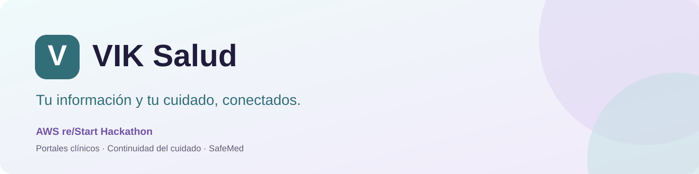
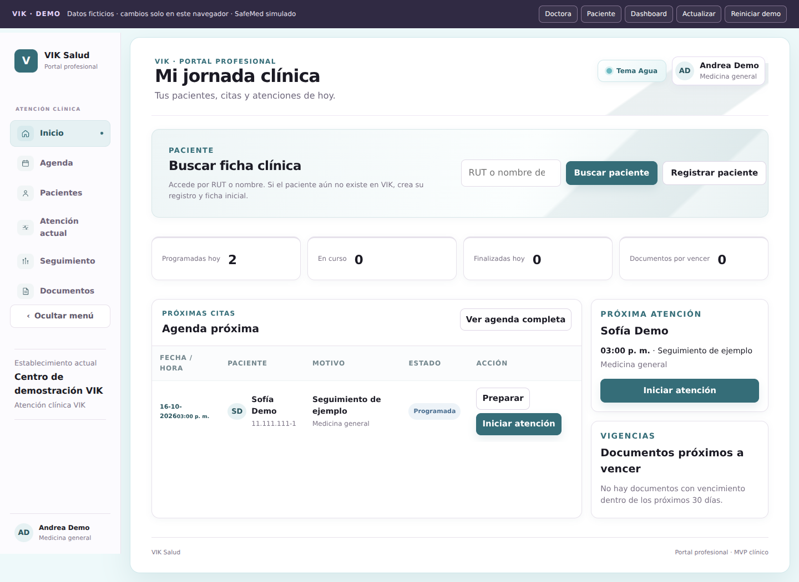
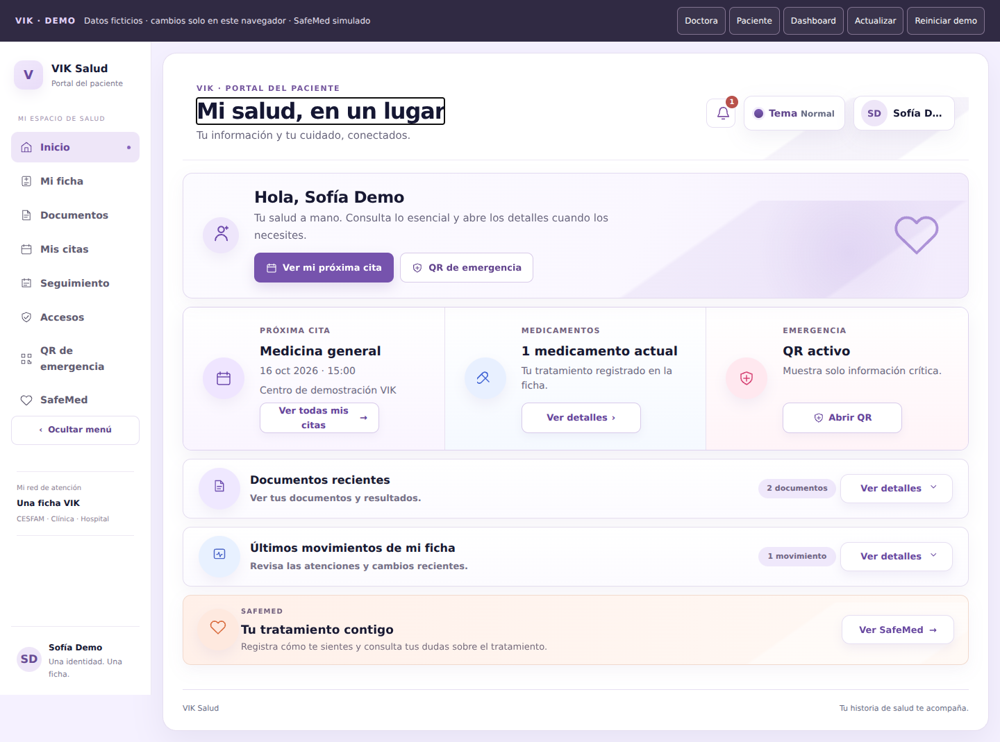
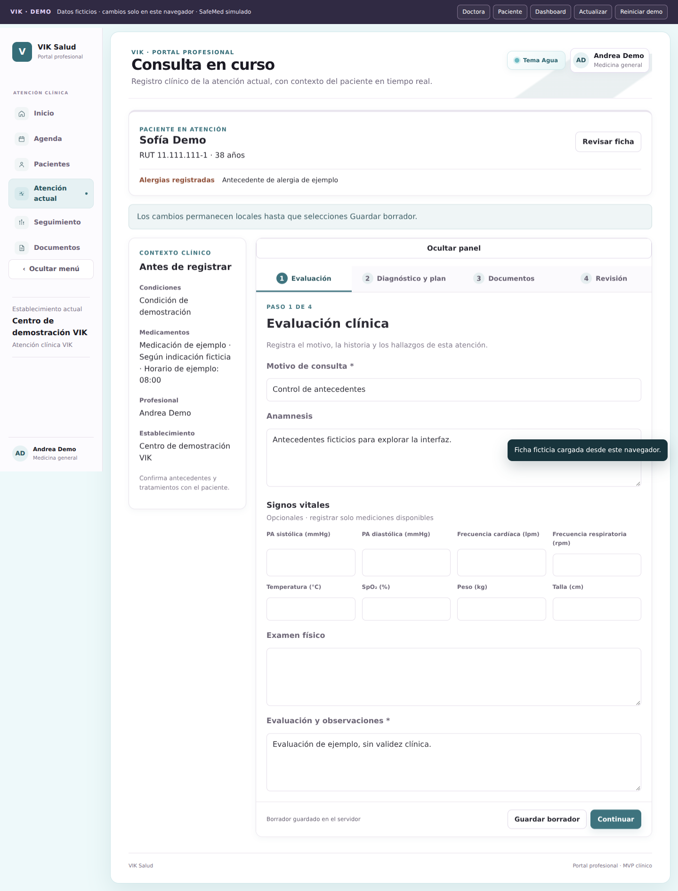

# VIK Salud

### AWS re/Start Hackathon

> Plataforma web para apoyar la continuidad del cuidado, organizar antecedentes clínicos y conectar el seguimiento entre pacientes y profesionales de salud.

## Equipo VIK Salud

- **Karina Wolf**
- **Valeria Palma**
- **Isskaba Fernandez**

## Descripción del proyecto

La información clínica de una persona suele estar distribuida entre hospitales, clínicas, CESFAM y documentos físicos. Cuando cambia de profesional o establecimiento, el paciente termina trasladando y reconstruyendo sus antecedentes, mientras parte de la consulta se utiliza para reunir información ya registrada. Después de la atención, recetas, controles e indicaciones también pueden quedar desconectados del seguimiento.

**VIK Salud** propone una capa complementaria centrada en el paciente para organizar antecedentes, documentos, autorizaciones y seguimiento. El MVP reúne estos procesos dentro de sus propios portales y un modelo de datos compartido. Su alcance inicial corresponde a una validación controlada, con un piloto regional propuesto; la integración automática con sistemas externos es una evolución futura.

## Los portales

### Portal profesional

Consulta de ficha y agenda, registro de atenciones, borradores, generación de documentos PDF y seguimiento del paciente. El acceso a la ficha se vincula a una autorización vigente.



### Portal paciente

Antecedentes, documentos, citas, solicitudes de acceso, seguimiento y un QR con información acotada de emergencia.



### Atención clínica

Recorrido de consulta con contexto, diagnóstico y plan, documentos y revisión antes de finalizar. Las capturas muestran exclusivamente datos ficticios.



## Arquitectura del MVP en AWS

El proyecto original utiliza servicios administrados y funciones serverless, junto con una base de datos relacional para los registros clínicos.

| Capa | Servicios y función |
| --- | --- |
| Frontend y distribución | **Amazon S3 y Amazon CloudFront** para los portales web |
| API y lógica de negocio | **Amazon API Gateway y AWS Lambda** para las operaciones de los portales y SafeMed |
| Datos clínicos | **Amazon RDS for PostgreSQL**, con configuración Multi-AZ documentada para el MVP |
| Autenticación del prototipo | **Amazon DynamoDB y Lambda de login** para las cuentas del MVP |
| Documentos | **Amazon S3**, en un bucket separado para los PDF y adjuntos |
| Apoyo con IA | **Amazon Bedrock, Nova 2 Lite**, mediante los módulos SafeMed médico y paciente |
| Permisos, red y observabilidad | **AWS IAM, Amazon VPC y Amazon CloudWatch**; acceso a S3 mediante un VPC Endpoint |

**SafeMed en el MVP original:** apoyo para revisar contexto y explicar indicaciones, sujeto a revisión humana. No emite diagnósticos ni recetas ni modifica tratamientos. No constituye un validador especializado de interacciones farmacológicas.

El modelo PostgreSQL relaciona ocho entidades: paciente, profesional, establecimiento, atención, recurso clínico, historial de cambios, solicitud de acceso y solicitud de seguimiento. El mapeo a HL7 FHIR R4 y los conectores con prestadores se contemplan como evolución.

## Qué contiene este repositorio

**Esta es la demo de portafolio. Funciona sin una cuenta de AWS, base de datos ni claves API.** Conserva las interfaces y adapta las integraciones a operaciones locales con datos ficticios guardados en el navegador.

- Portales profesional y paciente, login y dashboard de demostración.
- Registro y finalización de atenciones de ejemplo.
- Solicitudes de acceso y seguimiento para explorar el recorrido.
- Recetas, órdenes, derivaciones e indicaciones con las plantillas VIK.
- **Dos PDF iniciales completos**, ya incluidos: [Indicaciones de Sofía Demo](documents/Indicaciones_Demo_Sofia.pdf) y [Derivación de Sofía Demo](documents/Derivacion_Demo_Sofia.pdf).
- SafeMed **simulado**, con respuestas de ejemplo: no ejecuta IA ni evalúa tratamientos.

Los cambios permanecen en el navegador de cada visitante. La demo no intercambia datos con prestadores, no consulta el backend original y no emite documentos clínicos válidos.

## Probar en tu computador

Descomprime el proyecto. Desde la carpeta que contiene `index.html`, usa una de estas opciones:

```bash
# Con Node.js 20 o superior (sin instalar dependencias)
npm start

# O con Python 3
python -m http.server 8000 --bind 127.0.0.1
```

Abre **http://localhost:8000/**. En Windows también puedes usar `py -m http.server 8000 --bind 127.0.0.1`.

No abras el HTML con doble clic: usa HTTP local o GitHub Pages para que las rutas y el almacenamiento tengan un origen consistente.

## Accesos ficticios

La portada y el login permiten entrar con un clic. Si prefieres probar el formulario, todas las cuentas usan **`demo123`**, una contraseña de ejemplo pública:

| Rol | RUT de ejemplo | Identidad ficticia |
| --- | --- | --- |
| Doctor | `22.222.222-2` | Andrea Demo |
| Paciente | `11.111.111-1` | Sofía Demo |
| Paciente adicional | `55.555.555-5` | Tomás Demo |
| Directorio | `33.333.333-3` | Equipo Demo |

El login ilustra el flujo. Las credenciales se encuentran en el código público y **no son un mecanismo de autenticación seguro**.

## Recorrido de cinco minutos

1. **Doctora:** entra desde la portada, busca `11.111.111-1`, pulsa Buscar paciente y luego Abrir ficha clínica. Sofía tiene una autorización de ejemplo vigente.
2. **Atención:** inicia una atención, completa motivo y evaluación. Avanza a diagnóstico y plan, y prueba SafeMed para ver una respuesta explícitamente simulada.
3. **Documento:** en Documentos selecciona Indicaciones, completa ambos textos obligatorios, prepara el documento y finaliza la atención. También puedes explorar recetas, órdenes y derivaciones con campos ficticios.
4. **Paciente:** cambia usando la barra superior. En Documentos encontrarás el PDF de ejemplo emitido; en Mi ficha, el registro finalizado. Todo se conserva al recargar.
5. **Seguimiento:** acepta o rechaza la propuesta inicial. La aceptación crea una cita de ejemplo; una propuesta ya respondida no puede aceptarse dos veces.
6. **Permisos:** revoca el acceso de Andrea. Cambia a doctora, intenta abrir la ficha y envía una nueva solicitud. Regresa a paciente, acepta la solicitud y vuelve a doctora para continuar.
7. **QR:** genera, abre y desactiva el resumen ficticio de emergencia. Regenerar invalida el token anterior **en este navegador**.
8. **Dashboard:** revisa los indicadores y movimientos locales. Reiniciar demo restaura los ejemplos.

Si mantienes dos pestañas abiertas, pulsa **Actualizar** cuando la barra indique que hay cambios. Cambiar de portal en una pestaña selecciona la cuenta de demostración de ese rol.

## Qué funciona y qué se simula

| Función | Comportamiento de la demo |
| --- | --- |
| Portales y navegación | Pantallas originales adaptadas y rutas relativas compatibles con subcarpetas |
| Login | Cuentas públicas de ejemplo y sesión por pestaña |
| Ficha y agenda | Datos ficticios con fechas relativas al día de la primera visita |
| Edición y atención | Guardado local, borradores y finalización; cambios visibles desde paciente |
| Documentos | PDF iniciales incluidos y nuevos PDF generados localmente con plantillas VIK |
| Acceso clínico | Solicitud, aprobación, rechazo, revocación y vencimiento simulado |
| Seguimiento | Propuestas y respuestas persistidas; aceptación crea cita ficticia |
| QR | Codificación local y vista acotada; regeneración y revocación locales |
| SafeMed | Respuestas fijas y resumen de conteos locales, sin IA ni evaluación clínica |
| Dashboard | Indicadores calculados desde el estado ficticio local |
| AWS, correos y notificaciones externas | No se invocan; no se despliega infraestructura |

**Límites del almacenamiento:** las pestañas del mismo navegador y sitio comparten datos. Otros dispositivos, navegadores o visitantes tienen sus propios datos y no reciben las modificaciones. La revocación del QR tampoco se propaga a ellos. Un QR regenerado puede abrirse como enlace en la misma demo; no es un servicio público centralizado de emergencia.

Las fechas se fijan al crear los ejemplos por primera vez. Usa Reiniciar demo si quieres renovar la agenda para el día actual. Los registros nuevos de pacientes son ficticios; reciben una autorización de ejemplo para permitir explorar su ficha. El login solo ofrece las cuentas listadas arriba.

## Publicar en GitHub Pages

1. Crea un repositorio, por ejemplo `vik-salud-demo`.
2. Sube **el contenido de esta carpeta**, dejando `index.html`, `doctor/`, `paciente/`, `shared/` y el README en la raíz. No subas solamente el ZIP.
3. Para la opción más sencilla: **Settings → Pages → Deploy from a branch → main → /(root)** y guarda.
4. GitHub mostrará el enlace del sitio cuando termine de publicarlo. Prueba los accesos desde ese enlace.

La demo usa rutas relativas, por lo que funciona tanto en la raíz de un dominio como bajo el nombre del repositorio.

**Alternativa con Actions:** se incluye `.github/workflows/pages.yml`. Para usarla selecciona GitHub Actions como fuente en Settings → Pages. Ejecuta el workflow manualmente desde Actions; prueba el adaptador y publica los archivos. Si usas la opción de rama, puedes omitir o eliminar ese workflow para evitar confusión. Ninguna publicación se realizó al preparar este paquete.

[Documentación oficial de Pages](https://docs.github.com/en/pages/getting-started-with-github-pages/configuring-a-publishing-source-for-your-github-pages-site)

## Estructura

```text
index.html              Presentación y accesos de portafolio
login/                  Formulario de acceso ficticio
doctor/                 Portal profesional adaptado
paciente/               Portal paciente adaptado
qr/                     Resumen acotado de emergencia
VIK_dashboard/          Dashboard local
shared/demo.js          Datos ficticios y adaptador de operaciones locales
shared/qr.js            Codificador QR local
shared/demo.css         Barra y presentación de la demo
documents/              PDF iniciales completos de demostración
docs/images/            Capturas y banner del README
scripts/serve.cjs       Servidor estático local opcional
tests/demo.test.cjs     Pruebas del adaptador, sin dependencias
docs/                   Arquitectura y validación
.github/workflows/      Publicación opcional en Pages
```

## Pruebas

Con Node.js 20 o superior:

```bash
npm test
npm run check
```

Las pruebas verifican aislamiento entre pacientes, roles, revocación y renovación de permisos, finalización de atención, PDF, seguimiento, invalidación del QR y operaciones no soportadas. Ver [validación](docs/VALIDACION.md) para el recorrido probado en navegador.

## Documentación

- [Arquitectura y decisiones de la demo](docs/ARQUITECTURA.md)
- [Validación y pruebas](docs/VALIDACION.md)
- [Guía de carga inicial](LEEME_PRIMERO.txt)

## Autoría

Proyecto académico **VIK Salud**, desarrollado por **Karina Wolf, Valeria Palma e Isskaba Fernandez**, en el contexto de **AWS re/Start Hackathon**. Esta publicación presenta una adaptación estática para demostración y portafolio.
